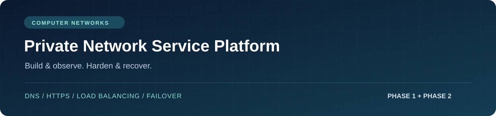
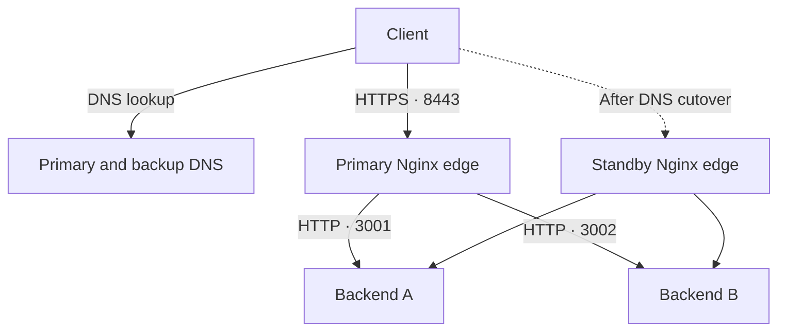

<p align="center">
  
</p>

<p align="center">
  <a href="https://github.com/kvianAR/CN_PROJECT_/actions/workflows/phase2.yml"></a>
</p>

# CN Project

**One repository. Two phases. A complete request path you can explain.**

A local networking platform built with **dnsmasq, Nginx, OpenSSL and two Python REST services**.
A client resolves a private domain, connects over trusted HTTPS, and receives a response from one
of two backends. Phase 2 extends that system with DNS redundancy, cache experiments, service
isolation, backend recovery and controlled edge migration.

[Quick start](#quick-start) · [Architecture](#architecture) · [Features](#what-is-included) ·
[Demo guide](Phase2/README.md) · [Test evidence](#verification) · [Documentation](#documentation)

> **Verified:** the saved local suite passed **6/6 tests, with no failures or skips**. The first
> GitHub Actions run also passed. Physical four-Mac firewall and client DNS cutover evidence has
> a separate status in the [report](Phase2/REPORT.md).

## Quick start

### Run everything locally

The local rehearsal starts temporary services on unused loopback ports. It needs no connection
to the other team members' Macs and leaves system DNS and firewall settings unchanged.

**Prerequisites:** Python 3, Nginx, dnsmasq, OpenSSL and zsh. Install missing tools on macOS:

```bash
brew install python nginx dnsmasq openssl
```

Clone and run:

```bash
git clone https://github.com/kvianAR/CN_PROJECT_.git
cd CN_PROJECT_
./RUN_CN.command
```

Already have the project? Open its folder and double-click **`RUN_CN.command`**.

| What happens | Where to find it |
|---|---|
| All six local tests run | Terminal output |
| Full transcript and structured summary are saved | `Evidence/Phase2/` |
| A combined report opens in your browser | `CN_REPORT.html` |
| Temporary services stop when tests finish | No persistent demo services remain |

The rehearsal takes about a minute. If a check fails or is skipped, the launcher reports it.
It does not label incomplete tests as passes.

### Deploy on the team Macs

Start with the [stepwise guide](Phase2/QUICKSTART_HI.md), then follow the
[deployment and demonstration runbook](Phase2/README.md).

Each machine needs current IPs, reachable peer services and the correct certificate setup.
Separate private networks need working routing or another approved connectivity arrangement;
matching project files alone does not connect remote Macs.

## Architecture



DNS returns the active edge's IP. The client then creates a separate HTTPS connection to that
edge. Nginx terminates TLS and forwards HTTP to a backend. Responses travel back through Nginx.
The DNS server does not carry application traffic.

| Machine | Supplied IPv4 | Primary responsibility | Phase 2 addition | Ports |
|---|---|---|---|---|
| **Mac 1** | `10.7.31.54` | Private DNS and test client | TTL and controlled record updates | DNS **53**, UDP/TCP |
| **Mac 2** | `192.168.1.7` | HTTPS edge and load balancer | Passive failover and upstream logs | HTTPS **8443**, TCP |
| **Mac 3** | `10.7.19.86` | Backend A | Standby HTTPS edge | **3001** and **8443**, TCP |
| **Mac 4** | `10.7.27.236` | Backend B and test client | Independent backup DNS | **3002**, TCP; **53**, UDP/TCP |

Use `app.team1.test` or `api.team1.test` for application access. The `.test` namespace avoids
macOS `.local`/mDNS conflicts. Current supplied addresses are recorded in the
[deployment inventory](Phase2/DEPLOYMENT_INVENTORY.md); verify them before a physical demo.

## What is included

### Phase 1 · Build and observe

| Feature | What it demonstrates |
|---|---|
| Private DNS | Both project names resolve to the edge |
| Two REST backends | Simple JSON services with distinct backend identifiers |
| Nginx reverse proxy | One HTTPS entry point for both applications |
| Round-robin balancing | Responses from both A and B |
| Trusted TLS | Certificate name/chain validation at the edge |
| HTTP caching | `Cache-Control`, ETag and conditional `304 Not Modified` |
| Packet evidence | DNS, TCP and TLS observations from the original submission |

### Phase 2 · Harden and recover

| Extension | Implementation | Demonstration |
|---|---|---|
| **A · Backup DNS** | Independent resolver with the same records | Stop primary; resolve through backup |
| **B · TTL and caching** | TTL **30 seconds**, reloadable records and a real caching resolver | Compare changed source answer with cached answer; expire or flush |
| **C · Service isolation** | Backend PF allowlist, saved rules and rollback | Client denied; edge allowed; application works |
| **D · Backend recovery** | Passive failure detection, bounded retries and recovery | Stop A; observe B; restart A; observe both |
| **E · Edge migration** | Standby Nginx, separate key and same-CA certificate | Update both resolvers; observe `X-Edge: standby` |
| **F · Troubleshooting** | Layered diagnostics, logs and capture commands | Isolate DNS, TCP, TLS, proxy or backend faults |

Backend source is reused from the final Phase 1 baseline. No web framework, database or Python
package installation is required for the application services.

## Choose the right launcher

| Entry point | Use it for |
|---|---|
| **`RUN_CN.command`** | Full local rehearsal, saved results and combined report |
| **`CHECK_PROJECT.command`** | Full local test suite and saved evidence |
| **`START_PHASE2.command`** | One foreground service at a time on its assigned Mac |
| `python3 Phase2/cn.py --help` | Configuration, verification, DNS, TLS, firewall and diagnostics |
| `python3 Phase2/finalize.py` | Refresh the report from saved results without running services |

Stop a foreground service with **Ctrl+C** in its own Terminal. Do not start Phase 1 and Phase 2
listeners on the same machine/address/port simultaneously.

## API and response headers

| Request | Response |
|---|---|
| `GET /` | Service and backend information |
| `GET /api/status` | `{"backend":"A","status":"ok"}` or the equivalent for B |
| `HEAD /api/status` | Response headers without a body |
| Conditional GET/HEAD with a matching ETag | `304 Not Modified` |
| Unknown path | `404 Not Found` |

| Header | Meaning |
|---|---|
| `X-Backend: A` / `B` | Application instance that served the response |
| `X-Edge: primary` / `standby` | Phase 2 edge that handled the request |
| `Cache-Control: public, max-age=60` | HTTP response freshness policy |
| `ETag` | Validator for that backend's representation |

**DNS TTL and HTTP cache freshness are different.** A matching ETag belongs to the backend's
representation; a conditional request routed to the other backend may return `200` instead of `304`.
Nginx does not configure a proxy micro-cache in this project.

## Verification

| Evidence | Result and scope |
|---|---|
| [Full six-test summary](Evidence/Phase2/20261123T043836.040132Z-full-test-summary.json) | **6/6 passed**, no failures/errors/skips; exact source hashes saved |
| [Complete test transcript](Evidence/Phase2/20261123T043836.040132Z-full-test-transcript.txt) | Actual local commands and service observations |
| [Eleven integration findings](Phase2/LOCAL_TEST_RESULTS.json) | Real DNS, TTL expiry, TLS, load balancing and failure/recovery checks |
| [GitHub Actions](https://github.com/kvianAR/CN_PROJECT_/actions) | Automated configuration, TLS and loopback integration checks |
| [Physical demonstration checklist](Phase2/REMAINING_LIVE_TESTS.md) | Tracks the separate four-Mac requirements |

Local and CI checks do not replace cross-Mac PF enforcement, actual OS resolver selection,
natural client DNS cutover or the faculty-injected challenge. See the
[Phase 2 report](Phase2/REPORT.md) for the recorded status.

## Documentation

| I want to… | Open |
|---|---|
| Start with short, stepwise instructions | [Quick start · Hinglish](Phase2/QUICKSTART_HI.md) |
| Run all six Phase 2 demonstrations | [Complete runbook](Phase2/README.md) |
| Set up a particular machine | [Mac 1](Mac%201%20-%20DNS/README.md) · [Mac 2](Mac%202%20-%20Edge/README.md) · [Mac 3](Mac%203%20-%20Backend%20A/README.md) · [Mac 4](Mac%204%20-%20Backend%20B/README.md) |
| Diagnose a fault and recover | [Troubleshooting](Phase2/docs/TROUBLESHOOTING.md) |
| Find screenshots, captures or test output | [Evidence index](Evidence/README.md) |
| Read the academic report | [Phase 2 report](Phase2/REPORT.md) |
| Read the course specification | [Project document](Shared/CN_Project_Doc.pdf) |
| Understand the topology and original Phase 1 work | [Shared documents](Shared/README.md) |

Generated configs, PIDs, machine-specific settings and private keys stay outside the tracked
source. Share public CA certificates and standby CSRs as instructed; keep private keys on their
own hosts. The runbook includes DNS and firewall rollback procedures.

## Team and project history

**Abhijeet Dey · Aditya Ranjan · Samriddhi Shah · Satwik Mani Triphati**

This repository extends [CWAbhi/CN_PROJECT_](https://github.com/CWAbhi/CN_PROJECT_).
The final Phase 1 baseline is commit
[`52a46de`](https://github.com/kvianAR/CN_PROJECT_/commit/52a46de198702b146ec60a2e5d6398dc92ab0def).
Phase 1 source/configuration and original evidence remain available in the same repository;
documentation has been refreshed for the combined project.

Built for Computer Networks coursework. The network behavior and the evidence behind it are the focus.
