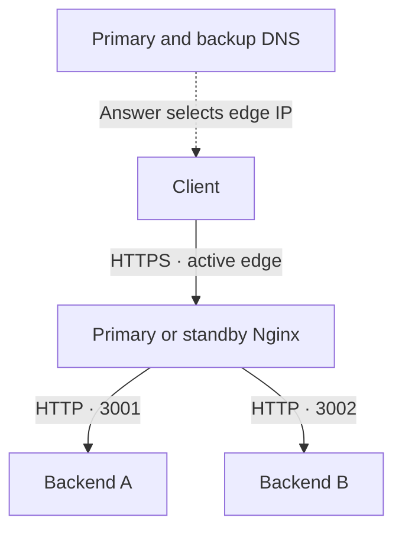

# Network topology and request flow

[Project overview](../README.md) · [Machine guides](README.md) · [Current inventory](../Phase2/DEPLOYMENT_INVENTORY.md)

## Physical roles

| Machine | Services | Receives connections on |
|---|---|---|
| Mac 1 | Primary DNS; client tools | UDP/TCP **53** |
| Mac 2 | Primary Nginx/TLS edge | TCP **8443** |
| Mac 3 | Backend A; standby Nginx/TLS edge | TCP **3001**, **8443** |
| Mac 4 | Backend B; backup DNS; client tools | TCP **3002**; UDP/TCP **53** |

## Application traffic

1. The client resolves `app.team1.test` or `api.team1.test` using a project DNS resolver.
2. The answer identifies the current edge. DNS does not forward the client's HTTP request.
3. The client opens TCP port 8443 and verifies the edge's TLS certificate.
4. Nginx terminates TLS and forwards HTTP to A or B.
5. The backend response returns through Nginx to the client over the encrypted connection.

## Protocol boundaries

| Segment | Protocol | What to observe |
|---|---|---|
| Client and resolver | DNS over UDP/TCP | Name, A answer, TTL and selected resolver |
| Client and edge | TCP, then TLS/HTTPS | Handshake, ports, certificate validation and encrypted application data |
| Edge and backend | HTTP over TCP | Selected backend, upstream response and `X-Backend` |
| DNS cutover | DNS record update plus client cache behavior | Old/new edge addresses and `X-Edge` |

Both edges use the same application hostnames and HTTPS port. Their certificates validate under
the same CA, with separate server keys. DNS cutover changes the address; it does not change the
port in a URL or terminate already established connections.

## Failure boundaries

- Backup DNS covers a primary **DNS service** outage.
- Backend retries cover a selected **application instance** outage.
- Standby edge migration is a **controlled procedure**, not automatic zero-interruption HA.
- PF restricts remote backend connections; local loopback tests have a different scope.

Private addresses on disconnected networks are not directly reachable merely because they appear
in configuration. Validate routing and device-to-device access before the physical demonstration.
